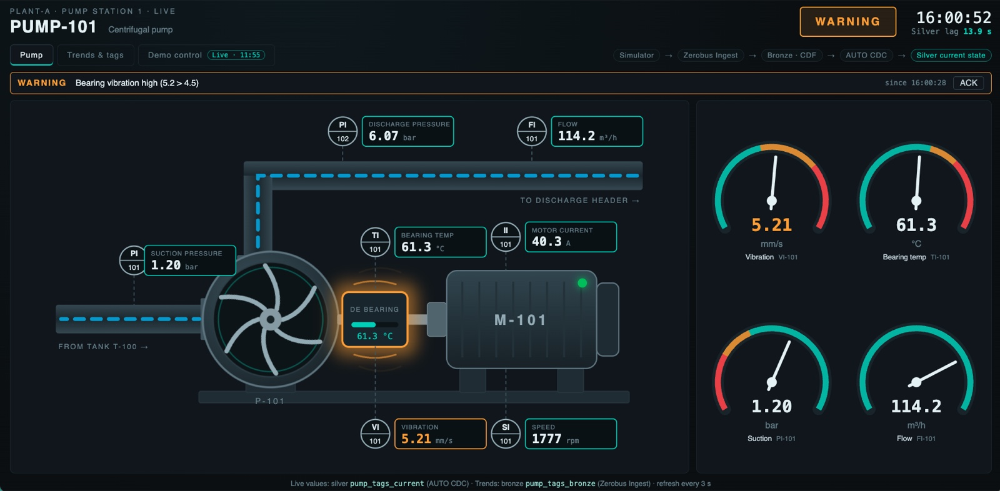

# Instructor demo: live pump telemetry with Zerobus Ingest

This project is a **Databricks Asset Bundle** that deploys a live, self-stopping demo of Zerobus
Ingest with a simulated centrifugal pump:

- live pump telemetry streaming through Zerobus Ingest into bronze;
- a silver current-state table maintained by AUTO CDC;
- a dashboard, and a plant-style operator screen built as a Databricks App.

## What's in this project

| Path | What it is |
|------|------------|
| `databricks.yml`, `resources/` | The bundle: its variables, and the schema, pipeline, jobs, dashboard and app it deploys |
| `solution/zerobus_sp.sh` | Creates the service principal the simulator authenticates as, and removes it after the demo |
| `solution/create_bronze.py` | Demo job task: creates the bronze table and grants access |
| `solution/stream_pump_data.py` | Demo job task: streams simulated pump data through Zerobus Ingest |
| `solution/silver_live_control.py` | Demo job tasks: start and stop the live silver pipeline |
| `solution/pump_simulator.py` | The centrifugal pump simulator |
| `solution/pump_silver_pipeline.py` | The silver pipeline: bronze change feed → AUTO CDC |
| `solution/zerobus_pump.lvdash.json` | The dashboard |
| `solution/hmi_app/` | The plant HMI app: FastAPI backend and React UI |
| `solution/zerobus-pump-instructor-demo.pdf` | This guide as a PDF, built with `tools/build_pdf.py` |

`stream_pump_data.py` runs the simulator with its scheduled stops turned off (`stops=False`), so a
fault develops without interruption. With stops on, the pump stops for 30-60 seconds every 5-10 minutes.

## What gets deployed

| Resource | Name | Purpose |
|----------|------|---------|
| Schema | `<catalog>.zerobus_pump_demo` | Holds the bronze and silver tables |
| Pipeline | `zerobus_pump_silver` | Bronze Change Data Feed → AUTO CDC → `pump_tags_current`, one row per tag |
| Job | `zerobus_pump_silver_live` | Runs the pipeline continuously. **Deployed paused**; only the demo job turns it on |
| Job | `zerobus_pump_demo` | The demo: creates bronze and grants, starts the live pipeline, streams pump data, stops the pipeline |
| Dashboard | `Zerobus Pump Live Demo` | KPIs, pump health, silver lag, 30-minute trends, current state per tag |
| App | `zerobus-pump-hmi` | Plant HMI: animated pump, alarms, gauges, trends, and **Start / Stop** buttons for the demo |

The `zerobus_pump_demo` job runs four tasks:

```
create_bronze ──┬── start_live_silver ──┐
                └── stream_pump_data ───┴── stop_live_silver   (runs even if streaming fails)
```

## Prerequisites

- A Unity Catalog workspace in a [Zerobus-supported region](https://docs.databricks.com/aws/en/resources/feature-region-support), with serverless compute and Databricks Apps.
- **Workspace admin**, to create the service principal and its OAuth secret.
- `CREATE SCHEMA` on the target catalog, and the right to grant `USE CATALOG` on it.
- Databricks CLI 1.x (validated with 1.20.0), authenticated to the workspace: `databricks auth login --profile <profile>`.
- `python3` on your machine (the helper script uses it to parse CLI output).
- A SQL warehouse named **Serverless Starter Warehouse** for the dashboard and the app, or pass another one with `--var warehouse_id=<id>`.

> **Shared workspace?** Resource names aren't prefixed with your user name, and schema and app names must be unique. If someone else already deployed the demo in the workspace, deploy with `--var schema=<your-schema> --var app_name=<your-app>`, and pass `-a <your-app>` to the cleanup script.

## 1. Create the service principal (once)

From the project root, the folder with `databricks.yml`:

```bash
solution/zerobus_sp.sh setup -p <profile>                 # uses the workspace's default catalog
solution/zerobus_sp.sh setup -p <profile> -c <catalog>    # or choose the catalog
```

The script:

1. Creates the service principal `zerobus-pump-demo-simulator`, or reuses it if it exists.
2. Generates a 30-day OAuth secret and stores it, with the application ID, in the secret scope `zerobus-pump-demo`. The secret is never printed.
3. Builds the Zerobus endpoint from the workspace ID, region, and cloud.
4. Writes the bundle variables to `.databricks/bundle/dev/variable-overrides.json`, so later commands need no `--var` flags.

Re-run it whenever the secret expires.

## 2. Deploy and start the app

```bash
databricks bundle deploy -p <profile>
databricks bundle run zerobus_pump_hmi -p <profile>
```

- **Deploy** creates everything but runs nothing. The live pipeline job is paused, the demo job only runs when you start it, and the app's compute stays stopped.
- **`bundle run zerobus_pump_hmi`** starts the app's compute and deploys its code. The platform installs the Python and npm packages and builds the React UI, which took about a minute in validation. The command prints the app URL; you can also find it under **Compute** > **Apps**.

The app's compute bills while it runs, so stop it between sessions:

```bash
databricks apps stop zerobus-pump-hmi -p <profile>
```

## 3. Run the demo

**From the app** (best for the room): open the app's URL, which `bundle run zerobus_pump_hmi` prints and which is also listed under **Compute** > **Apps**. This is the plant screen described below. On its **Demo control** tab, choose a fault (**Healthy**, **Bearing fault**, or **Cavitation**), when it should raise its first WARNING and ALARM, and a duration, then click **▶ Start demo**.

**From the CLI**, the same job:

```bash
databricks bundle run zerobus_pump_demo -p <profile>
# shorter run, different fault:
databricks bundle run zerobus_pump_demo -p <profile> --params demo_minutes=5,fault=cavitation
# a faster bearing fault: WARNING at 2 minutes, ALARM at 4
databricks bundle run zerobus_pump_demo -p <profile> --params demo_minutes=6,fault=bearing,warning_minutes=2,alarm_minutes=4
```

The defaults are 15 minutes with a developing **bearing fault**.

You set how fast the fault develops by choosing when its first WARNING and ALARM appear, in minutes
after streaming starts. Leave `warning_minutes` and `alarm_minutes` empty for the defaults:

| Fault | First WARNING | First ALARM |
|-------|---------------|-------------|
| Bearing fault | Vibration over 4.5 mm/s at `warning_minutes`, default 7 | Vibration over 7.1 mm/s at `alarm_minutes`, default 13 |
| Cavitation | Suction pressure under 0.8 bar at `warning_minutes`, default 7.5 | Suction pressure under 0.5 bar at about 1.8 × `warning_minutes`, about 13.4 by default. The alarm time can't be set separately. |

The screen shows each one about 15 seconds after it happens. Bearing temperature follows vibration
by a minute or two, because the bearing heats up slowly. Make the duration longer than the alarm
time if you want the room to see the alarm. In validation:

- streaming started about 30 seconds after the job started;
- silver was live about a minute in;
- the whole job took about 1.5 minutes longer than its duration.

### The plant screen



The screen has three tabs, each sized to fit the window without scrolling. The top bar and the alarm
annunciator stay visible on every tab. The **Demo control** tab's label shows the run's status, for
example **Live · 12:34**, so you can follow the run from the other tabs.

- **Pump:** the process graphic and gauges for vibration, bearing temperature, suction pressure, and flow.
  - The impeller turns at motor speed, and flow animates through the suction and discharge pipes.
  - ISA-style instrument tags (PI-101, FI-101, TI-101, VI-101, …) show live values from silver.
  - As the bearing fault develops, the bearing housing glows amber, then red, and vibration waves pulse around it.
  - During cavitation, vapour bubbles appear at the pump inlet.
- **Trends & tags:** 10-minute trends of bearing vibration and temperature from bronze, with their H and HH limits, and the silver tag table with each value's quality and age.
- **Demo control:** choose the fault, when it raises its first WARNING and ALARM, and the duration; start and stop the demo; and follow the run. The tab checks the times: the alarm must come after the warning, and it tells you if either comes after the demo ends.
  - The run status says where the run is: creating the bronze table, starting the simulator, streaming into bronze, live, and stopping. It's based on the job's task states and on the data reaching the screen: **Live** means this run's readings have reached silver. While you wait, it counts down to the next step.
  - The job's four tasks are listed as waiting, running, or done, with a link to the job run.
  - **■ Stop** cancels the run and then stops the live pipeline. In validation, the pipeline was idle about 30 seconds after clicking Stop.

Also on the screen:

- **Alarm annunciator:** WARNING and ALARM rows flash until you click **ACK**, and the health indicator in the top bar follows the worst alarm. Between demo runs, silver keeps the last run's values, so the health indicator reads **IDLE · last values**, any alarm rows are greyed out and marked **last run**, and the top bar shows the time of the last reading instead of the silver lag. With the default times, the bearing fault raises its first WARNING at about 7 minutes and its first ALARM at about 13; cavitation raises its first WARNING at about 7.5 minutes.
- **Silver lag** in the top bar stayed around 12-19 seconds on screen while streaming. That's the pipeline's 8-12 seconds plus the screen's 3-second refresh.

The app reads with its own service principal. The demo job's first task grants it `USE CATALOG`, plus `USE SCHEMA` and `SELECT` on the demo schema. Until the first demo run, the screen shows "Waiting for the first demo run". The app only queries the warehouse while a demo runs and for about 90 seconds afterwards, so leaving the screen open doesn't keep the warehouse awake.

### The dashboard

```bash
databricks bundle open zerobus_pump_dashboard -p <profile>
```

Refresh it every so often while the demo runs. Things worth showing:

- **Readings ingested (last 5 min)** climbs to about 2,400 (8 tags × 1 scan/s × 5 minutes), all written straight into Delta with no message bus.
- **Current state** keeps exactly one row per tag, however much data lands in bronze.
- The pipeline graph (`databricks bundle open zerobus_pump_silver -p <profile>`): the change feed view, the AUTO CDC flow, and data quality metrics from the expectations.

When the stream finishes, the job stops the live pipeline. Nothing is left running except the app.

> **If you cancel the demo job** from the Jobs UI or the CLI, the live pipeline keeps running. Click **■ Stop** in the app, or run:
>
> ```bash
> databricks bundle run zerobus_pump_demo -p <profile> --only stop_live_silver
> ```

## 4. Run it again (already deployed)

You don't need to redeploy to give the demo again. First check four things:

1. **Nothing is still running.** The app's demo panel should say **Idle**. If you cancelled the last run outside the app, stop the live pipeline first with **■ Stop** or `--only stop_live_silver`, as above.

2. **Credentials are current.** Run setup again if any of these apply:
   - the secret is more than 30 days old;
   - you're on a different machine or in a fresh clone, since the bundle variables live in the local `.databricks/` folder;
   - you ran `cleanup`.

   ```bash
   solution/zerobus_sp.sh setup -p <profile>
   ```

   It reuses the existing service principal and secret scope, and stores a new 30-day secret. If the CLI says your login has expired, run `databricks auth login --profile <profile>` first.

3. **The deployment is current.** If you've changed the project's files since the last deploy, deploy again and redeploy the app's code. Deploying never starts the demo.

   ```bash
   databricks bundle deploy -p <profile>
   databricks bundle run zerobus_pump_hmi -p <profile>
   ```

4. **The app is running.** If you stopped it, start it again with `databricks bundle run zerobus_pump_hmi -p <profile>`.

Then start the demo in one of two ways:

- **Keep the existing data**: click **▶ Start demo** in the app, or run `databricks bundle run zerobus_pump_demo -p <profile>`.

  The simulated pump starts healthy again. Until the new run's silver goes live, about 1.5 minutes after the start, the screen keeps showing the previous run's last values. Then the new readings replace them. The trend charts show the last 10 minutes (app) and 30 minutes (dashboard), so earlier readings appear only if the previous run ended within that window.

- **Start from empty tables**: destroy and redeploy the bundle, then start the app and run the demo.

  ```bash
  databricks bundle destroy -p <profile>
  databricks bundle deploy -p <profile>
  databricks bundle run zerobus_pump_hmi -p <profile>
  ```

  This keeps the service principal and secret scope. It recreates the schema, tables, pipeline, jobs, dashboard and app. The dashboard gets a new URL, and the old one goes to the workspace Trash.

## 5. Clean up

Run the cleanup script **first**, while the app still exists, then destroy the bundle:

```bash
solution/zerobus_sp.sh cleanup -p <profile>
databricks bundle destroy -p <profile>
```

- **The cleanup script** revokes the `USE CATALOG` grants of the Zerobus service principal and the app, then deletes the secret scope and the service principal. It keeps the local bundle variables, which `bundle destroy` still needs.
- **`bundle destroy`** removes the app, the jobs, the pipeline with its silver table, the schema with the bronze table, and the bundle's workspace files. It moves the dashboard to the workspace Trash. App deletion finishes in the background.

## Work on the app locally

The app's code is in `solution/hmi_app/`: a FastAPI backend (`app.py`, `plant_data.py`) and a React UI built with Vite (`src/`). To preview the screen without a workspace, run it in mock mode against the demo's copy of the simulator:

```bash
cd solution/hmi_app
# The simulator imports the Zerobus SDK, so install it with the app's packages.
pip install -r requirements.txt databricks-zerobus-ingest-sdk==1.10.0
npm install && npm run build
HMI_MOCK=1 HMI_MOCK_SPEED=30 python app.py    # http://localhost:8000; faults develop 30x faster
```

In mock mode, **▶ Start demo** steps through the run's stages in about 20 seconds, then streams for the chosen duration.

Set `DATABRICKS_APP_PORT` to use a port other than 8000.

## Rebuild the PDF

After you edit this guide, rebuild `solution/zerobus-pump-instructor-demo.pdf` from the project root.
The script needs [pandoc](https://pandoc.org) and WeasyPrint's system libraries; on macOS, run
`brew install pandoc pango`.

```bash
python3 -m venv .venv && .venv/bin/pip install weasyprint beautifulsoup4 certifi   # once
DYLD_FALLBACK_LIBRARY_PATH=/opt/homebrew/lib .venv/bin/python tools/build_pdf.py
```

The cover page's summary, steps and facts are set in `tools/build_pdf.py`, not in this guide.
